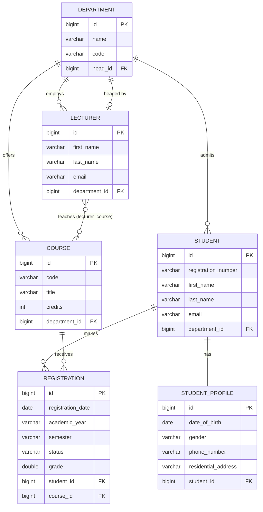

# University Course Registration and Academic Management System

Web Technology and Internet: Individual Assignment (Model and Repository layers)

**Student Name:** Nicole UMUTONIWASE  **Registration No.:** 27280

**Stack:** Java 17, Spring Boot 3.3.5, Spring Data JPA / Hibernate, PostgreSQL (`university_academic_db`), Maven, VS Code

---

## 1. Problem Analysis

A university manages departments, students, lecturers, courses and course registrations. Information is currently kept manually, so records are hard to manage. The system stores departments, students (with one profile each), lecturers, courses, and the registrations that link students to courses.

## 2. Identified Entities

| # | Entity | Reason |
|---|--------|--------|
| 1 | Department | The university has several departments, each with courses, lecturers, students and one head |
| 2 | Student | Students are admitted and assigned to a department |
| 3 | StudentProfile | Each student has exactly one profile with personal details |
| 4 | Lecturer | Lecturers work in a department and teach courses |
| 5 | Course | Each course belongs to one department |
| 6 | Registration | Join entity: the student-course link carries its own data (date, year, semester, status, grade) |

The Lecturer-Course assignment is **not** an entity. It is a plain join table (`lecturer_course`), as the assignment requires.

## 3. Attributes

| Entity | Attributes |
|--------|-----------|
| Department | id, name, code |
| Student | id, registrationNumber, firstName, lastName, email |
| StudentProfile | id, dateOfBirth, gender, phoneNumber, address |
| Lecturer | id, firstName, lastName, email |
| Course | id, code, title, credits |
| Registration | id, registrationDate, academicYear, semester, status (PENDING / APPROVED / REJECTED), grade |

## 4. Relationships and Cardinality

| # | Relationship | Cardinality | Implementation |
|---|--------------|-------------|----------------|
| 1 | Department - Course | One-to-Many | FK `courses.department_id` |
| 2 | Department - Lecturer (employs) | One-to-Many | FK `lecturers.department_id` |
| 3 | Department - Lecturer (head) | One-to-One | FK `departments.head_id` (unique) |
| 4 | Department - Student | One-to-Many | FK `students.department_id` |
| 5 | Student - StudentProfile | One-to-One | FK `student_profiles.student_id` (unique) |
| 6 | Lecturer - Course (teaches) | Many-to-Many | **Join table** `lecturer_course` |
| 7 | Student - Course (registers) | Many-to-Many | **Join entity** `Registration` (two One-to-Many / Many-to-One links) |

### Which relationships need what

- **Foreign keys:** relationships 1, 2, 3, 4, 5 and the two sides of 7 (`registrations.student_id`, `registrations.course_id`).
- **Join table:** Lecturer-Course (`lecturer_course`), because it has no extra data and must not be an entity.
- **Join entity:** Student-Course (`Registration`), because it stores registration date, academic year, semester, status and grade.

## 5. Entity Relationship Diagram



(Export this diagram as an image for the submission, for example via https://mermaid.live or the GitHub preview.)

## 6. Relational Database Schema

```
departments       (id PK, name, code, head_id FK -> lecturers.id)
lecturers         (id PK, first_name, last_name, email, department_id FK -> departments.id)
students          (id PK, registration_number, first_name, last_name, email, department_id FK -> departments.id)
student_profiles  (id PK, date_of_birth, gender, phone_number, residential_address, student_id FK -> students.id UNIQUE)
courses           (id PK, code, title, credits, department_id FK -> departments.id)
lecturer_course   (lecturer_id FK -> lecturers.id, course_id FK -> courses.id)   -- composite PK (lecturer_id, course_id)
registrations     (id PK, registration_date, academic_year, semester, status, grade,
                   student_id FK -> students.id, course_id FK -> courses.id)
                   UNIQUE (student_id, course_id, academic_year, semester)
```

## 7. Project Structure

```
src/main/java/com/university/academic
  AcademicApplication.java
  model/        Department, Student, StudentProfile, Lecturer, Course, Registration, RegistrationStatus
  repository/   one JpaRepository per entity
src/main/resources/application.properties
```

## 8. How to Run

1. Create the database: `CREATE DATABASE university_academic_db;`
2. Set your PostgreSQL password in `application.properties` (or set the `DB_PASSWORD` environment variable).
3. Run `mvn spring-boot:run`.
4. Hibernate creates the tables automatically (`spring.jpa.hibernate.ddl-auto=update`).

## 9. Screenshots

Place the screenshots in the `screenshots/` folder:

- Application startup and Hibernate table creation logs
- Tables list in PostgreSQL (`\dt`)
- Foreign keys / join table (`\d registrations`, `\d lecturer_course`)
